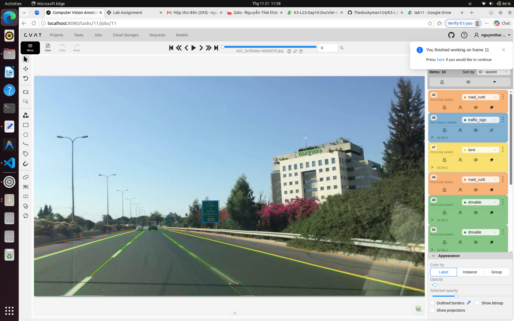
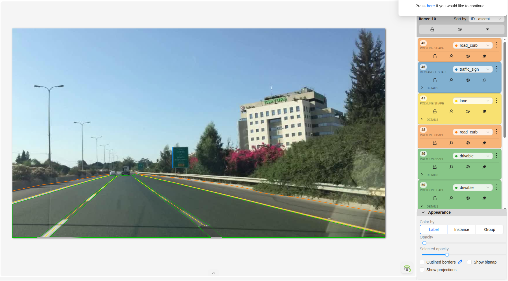
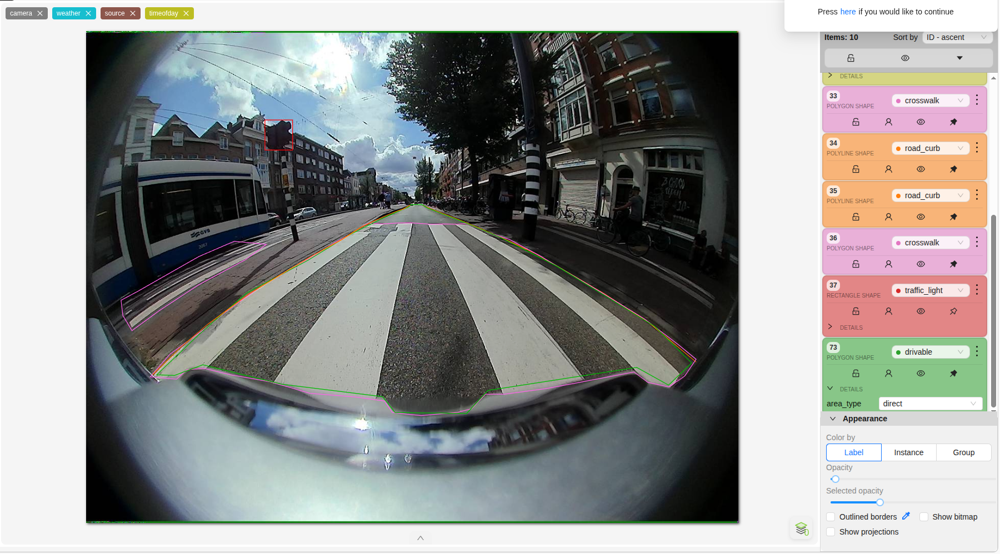
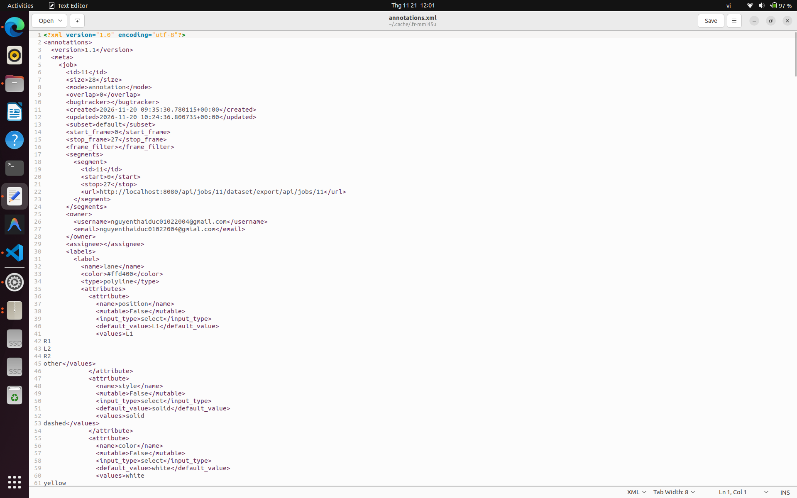

# Báo cáo cá nhân — Ngày 11 · Road Elements & SVM

**Họ tên:** Nguyễn Thái Đức

**Mã học viên:** 2A202603293 · **Lớp:** AI20K K5

**Guideline:** Road v1.0

**Ngày cập nhật báo cáo:** 21/11/2026

**Phiên bản CVAT (Help → About):** Chưa xác nhận; phiên bản XML export là `1.1`, không phải phiên bản ứng dụng CVAT.

**Lần nộp (`revision`):** `1` trong manifest mới tạo cho bộ nộp đầu tiên; chưa xác minh lịch sử nộp trên kênh của lớp.

**Số lần nộp lại sau Rework:** Chưa có lịch sử nộp để xác nhận.

Thời điểm export lấy từ trường `meta/dumped` trong XML, đã đổi sang giờ Việt Nam (UTC+7):

| File | Thời điểm export |
| --- | --- |
| `NguyenThaiDuc-front.zip` | 20/11/2026, 18:26:56 |
| `NguyenThaiDuc-fisheye.zip` | 21/11/2026, 09:19:43 |

Báo cáo sử dụng hai file ZIP hiện có và [phiếu QC 1 đã điền](NguyenThaiDuc-qc1-for-2A202603265.md). Hai file chứa đúng 12 ảnh front và 8 ảnh fisheye bắt buộc; chưa có ảnh thêm. Kiểm tra file cho thấy còn lỗi cần xử lý trước khi nộp. Các thông tin chưa có bằng chứng được ghi rõ, không tính là đã hoàn thành.

## 1. Kiểm project

Đối chiếu khai báo label trong cả hai XML với [cấu hình Road v1.0](configs/road_v1_labels.json):

| Mục | Đúng như guideline Road v1.0? | Ghi chú |
| --- | --- | --- |
| 6 label, đúng kiểu | Đúng trong XML | `lane`, `road_curb`: polyline; `crosswalk`, `drivable`: polygon; `traffic_light`, `traffic_sign`: rectangle (shape trong XML là `box`). |
| Thuộc tính và giá trị khai báo | Đúng trong XML | Tên, kiểu nhập, tập giá trị, giá trị mặc định và cờ `mutable` khớp cấu hình. Giá trị gán trên từng ảnh vẫn cần kiểm riêng. |
| 4 label Tag ảnh | Khai báo đúng; gán chưa đủ/đúng trên mọi ảnh | Có `camera`, `timeofday`, `weather`, `source`, mỗi label có thuộc tính select `value`. A01 thiếu cả bốn tag; B02 gán `camera=front` thay vì `fisheye_front`. |

**Cách kết thúc polyline:** Theo [hướng dẫn CVAT của lớp](docs/huong_dan_cvat_bang_hinh.md), chọn Polyline → Shape, đặt điểm từ gần ra xa, bấm **N** để kết thúc. Chưa có xác nhận trực tiếp phiên bản CVAT đang dùng.

**Cách đặt tag ảnh:** Dùng công cụ Tag ở thanh bên trái, thêm `camera` trước rồi `timeofday`, `weather`, `source`; mở Details và sửa thuộc tính `value` theo ảnh. Không giữ mặc định mà bỏ qua bước kiểm. Ảnh BDD100K và WoodScape trong bài dùng `source=real`.

## 2. Số lượng đã gán

Số liệu đếm trực tiếp các shape trong `annotations.xml`; không cộng tag vào cột số shape. Số ảnh trong file không đồng nghĩa mọi ảnh đã gán đủ yêu cầu.

| Task | Ảnh trong export | lane | road_curb | crosswalk | drivable | traffic_light | traffic_sign |
| --- | ---: | ---: | ---: | ---: | ---: | ---: | ---: |
| front — A01–A12 | 12 | 29 | 0 | 0 | 0 | 0 | 0 |
| front-extra — 0/4 ảnh có trong export | 0 | 0 | 0 | 0 | 0 | 0 | 0 |
| fisheye — B01–B08 | 8 | 8 | 11 | 14 | 0 | 2 | 5 |
| fisheye-extra — 0/4 ảnh có trong export | 0 | 0 | 0 | 0 | 0 | 0 | 0 |
| **Tổng** | **20** | **37** | **11** | **14** | **0** | **2** | **5** |

- Tổng cộng **69 shape + 76 tag = 145 nhãn** trong hai file.
- Front có 29 shape và 44 tag; 11/12 ảnh đủ bốn tag. A05 chưa có shape nào.
- Fisheye có 40 shape và 32 tag; 8/8 ảnh đủ bốn tag, nhưng tag camera của B02 sai.
- Có 19/20 ảnh chứa ít nhất một shape. Đây là số ảnh có nhãn hình học, không phải số ảnh đạt chất lượng.
- File front hiện chỉ có `lane`; cả hai file đều chưa có `drivable`. Cần kiểm lại bản export và hoàn thiện các nhóm label theo kế hoạch từng ảnh trước khi nộp.

## 3. Bảng ca khó

Các lựa chọn dưới đây được đối chiếu với XML hiện tại và guideline. Những việc cần sửa được ghi rõ, chưa coi là đã sửa trên CVAT.

| Ảnh | Nhãn | Phân vân giữa | Đã chọn / tình trạng hiện tại | Lý do và hướng xử lý |
| --- | --- | --- | --- | --- |
| A04 | `lane` | Vạch vàng đôi hay vạch đơn; xác định vạch sát làn xe | Vạch bên trái mang `L1 / solid / yellow / double` | Ảnh gốc có hai nét vàng liền song song bên trái làn xe. `kind=double` mô tả vạch đôi; `position` căn cứ làn đang đi, không căn cứ thứ tự vẽ. |
| A05 | `lane`, `drivable` | Không thấy vạch sơn nhưng vẫn có mặt đường xe đi được | XML chưa có shape | Không tự tạo L1/R1 từ hàng xe đỗ. Cần coach xác nhận ngoại lệ QC1-02; bổ sung vùng lái theo yêu cầu ảnh, loại dải đỗ xe sát lề và phần capô. Không có lane không đồng nghĩa không có vùng lái. |
| A08 | `lane` | Một vạch liên tục hay hai đoạn có `style` khác nhau | Có hai polyline `position=L1`, một `solid`, một `dashed` | Lint báo QC1-05. Cần xem lại cùng ảnh để xác định có tách một vạch hay không; nếu vạch đổi kiểu mà Road v1.0 chưa quy định cách biểu diễn, hỏi lead và ghi quyết định. |
| B02 | Tag `camera` | `front` hay `fisheye_front` | Đang là `front`, cần đổi thành `fisheye_front` | Tên ảnh có hậu tố `FV` và thuộc bộ fisheye. Sai camera khiến checker áp dụng quy tắc front và phát sinh thêm cảnh báo thiếu L1/R1. |
| B05–B08 | `lane.position` | L1/R1/R2 hay `other` | Sáu lane đang mang L1/R1/R2; cần sửa thành `other` nếu đúng là lane | Camera MVL/MVR là camera hai bên; Road v1.0 quy định mọi lane ở đây có `position=other`. Nếu đối tượng là vạch ngựa vằn hoặc vạch ô đỗ thì phải xem lại cả label. |
| B06 | `crosswalk`, `lane`, vùng thân xe | Vạch ngựa vằn bị cong hay vạch phân làn | XML có hai polygon crosswalk và một lane; cần rà soát phạm vi | Ảnh gốc có vạch ngựa vằn bị biến dạng mạnh và thân xe ở tiền cảnh. Mỗi vùng crosswalk cần polygon bao cả vùng, không gán từng vệt thành lane; không gán thân xe vào vùng lái. |
| B03, B04 | `traffic_sign.edge_zone` | Đối tượng sát mép có cần bật `edge_zone` không | B03 `traffic_sign#3` và B04 `traffic_sign#0` đang để `false` | Lint gợi ý tâm box nằm ngoài 80% bán kính. Cần đối chiếu vòng ảnh, bật cờ khi đúng điều kiện; box vẫn là hình chữ nhật sát pixel. |

## 4. Phiếu QC 1 nhận được và phản hồi

**Người kiểm lô của tôi:** Chưa có phiếu nhận về trong thư mục.

**Quyết định nhận được:** Chưa xác nhận.

**Phản hồi / sửa theo phiếu nhận về:** Chưa thể ghi nhận khi chưa có phiếu. Bảng dưới là kết quả tự kiểm bằng lint, không thay thế phiếu của bạn kiểm.

| Mã lỗi | Số cảnh báo lint | Đồng ý / cần xác minh | Đã sửa? |
| --- | ---: | --- | --- |
| QC1-01 | 5: 2 nặng, 3 nhẹ | Xác nhận A01 thiếu bốn tag; B02 sai camera | Chưa, vẫn xuất hiện trong XML hiện tại |
| QC1-02 | 8 nặng | A05 thiếu L1/R1; A06, A09, A10 thiếu R1; A07 thiếu L1; B02 thiếu L1/R1 theo camera đang gán sai. Cần xem ảnh/coach xác nhận, sửa camera B02 rồi chạy lại lint | Chưa có xác nhận ngoại lệ hoặc bản sửa |
| QC1-03 | 6 nặng | Xác nhận sai quy tắc `position=other` tại B05 (1), B06 (1), B07 (3), B08 (1) | Chưa |
| QC1-05 | 2 chính | A08 trùng L1; B07 trùng R1. Cần kiểm hình học; sửa position ở B07 trước khi đánh giá lại | Chưa |
| QC1-11 | 2 chính | Gợi ý kiểm `edge_zone` của biển ở B03 và B04 | Chưa |
| **Tổng** | **23: 16 nặng, 4 chính, 3 nhẹ** | Đây là cảnh báo của công cụ, có thể có cảnh báo kéo theo cùng một nguyên nhân | Cần xử lý và kiểm lại |

**Tự đánh giá trạng thái bàn giao: cần Rework.** Thiếu/sai camera và sai position ở camera hai bên đã được xác nhận từ XML. Các cảnh báo thiếu làn chỉ được miễn khi coach xác nhận ảnh thật sự không thấy vạch; không vẽ thêm vạch chỉ để hết cảnh báo. Không dùng `4/145` làm tỉ lệ lỗi chính của phiếu QC: lint chưa kiểm chất lượng hình học toàn bộ 145 nhãn theo GT.

**Phiếu tôi đã kiểm cho bạn khác:** [NguyenThaiDuc-qc1-for-2A202603265.md](NguyenThaiDuc-qc1-for-2A202603265.md) ghi người được kiểm là **2A202603265**, người kiểm là **2A202603293**, ngày **20/11/2026**. Mẫu gồm 6 ảnh, 73 nhãn; ghi nhận 0 lỗi nặng, 5 lỗi chính và 2 lỗi nhẹ. Tỉ lệ lỗi chính `5/73 × 100 = 6,85%`, vượt 5%, nên quyết định **Rework**. Đây là quyết định đối với lô của bạn được kiểm, không phải phiếu nhận về của tôi.

Các điểm rút ra từ phiếu đã viết: kiểm sát tâm vạch ở A04, rà vùng lái sát dải đỗ xe ở A05, kiểm thuộc tính biển A01/A06 và tag thời điểm A03/A04. Phiếu không có mục kiểm fisheye, nên không suy rộng kết quả đó sang bộ B.

## 5. Kiểm file export

| File | Mở lại được? | Số shape ảnh 1 (job / file) | Số shape ảnh 2 (job / file) | Tag camera có trong XML? |
| --- | --- | --- | --- | --- |
| `NguyenThaiDuc-front.zip` | Có, đọc được `annotations.xml`, version `1.1` | A01: chưa đối chiếu job / **4** | A02: chưa đối chiếu job / **3** | 11/12 ảnh có, đều là `front`; A01 thiếu |
| `NguyenThaiDuc-fisheye.zip` | Có, đọc được `annotations.xml`, version `1.1` | B01: chưa đối chiếu job / **5** | B02: chưa đối chiếu job / **6** | 8/8 ảnh có; B02 sai giá trị, 7 ảnh còn lại khớp hướng camera |

Cả hai ZIP chỉ chứa `annotations.xml`, **không kèm ảnh**. File front có A01–A12, file fisheye có B01–B08; không còn trùng mã ảnh giữa hai file. Khai báo `meta/job/size` không được dùng thay số phần tử `<image>` thực tế khi thống kê.

Lệnh đã chạy tại thư mục gốc:

```bash
PYTHONPATH=src python3 -m road_lab.road_check selftest
PYTHONPATH=src python3 -m road_lab.road_check lint NguyenThaiDuc-front.zip NguyenThaiDuc-fisheye.zip --manifest NguyenThaiDuc-manifest.json --name NguyenThaiDuc --revision 1
```

Kết quả: `SELFTEST PASS`; lint đọc được **20 ảnh, 23 cảnh báo**. Selftest kiểm công cụ bằng dữ liệu tổng hợp; lint kiểm định dạng và một số quy tắc, không xác nhận nhãn đạt GT hoặc cho điểm bài nộp.

Đã tạo [NguyenThaiDuc-manifest.json](NguyenThaiDuc-manifest.json) với `revision=1`, ghi số ảnh, số shape, SHA-256 và 23 cảnh báo lint của hai ZIP hiện tại. Cả hai file có `contains_images=false`. Manifest mô tả bộ file, không xác nhận bài đạt chất lượng. Chưa xác minh trạng thái `completed` của job trên CVAT. Khi thay ZIP, cần tạo lại manifest để cập nhật SHA-256 và thống kê. Nếu nộp lại sau Rework, giữ bản trước rồi tăng `revision` theo [đặc tả bàn giao](docs/delivery_road_v1.0.md).

## 6. Ảnh chụp màn hình và minh chứng XML

Bốn ảnh dưới đây ghi lại giao diện CVAT và file XML của bài cá nhân. Ảnh camera trước thể hiện lane, road_curb, drivable và traffic_sign; ảnh fisheye thể hiện crosswalk, road_curb, traffic_light và drivable.

### 6.1. Danh sách đối tượng và label trong job



**Hình 1 — A01 trong CVAT.** Bảng Objects bên phải hiển thị `Items: 10`, gồm các đối tượng mang label `road_curb`, `traffic_sign`, `lane` và `drivable`. Ảnh minh họa cách các label được sử dụng trong job. Dù tên file là `tab_label.png`, đây là bảng Objects, chưa phải tab Labels của project; chưa thể dùng riêng ảnh này để xác nhận đầy đủ cấu hình sáu label và bốn Tag. Phần cấu hình đã được đối chiếu từ XML ở mục 1.

### 6.2. Ảnh camera trước đã gán nhãn



**Hình 2 — Các nhóm nhãn trên ảnh camera trước A01.** Polyline màu vàng thể hiện lane; polyline màu cam thể hiện road_curb; polygon viền xanh lá thể hiện drivable; box xanh dương bao biển báo. Bảng Objects hiển thị kiểu hình tương ứng: polyline, polygon và rectangle. Ảnh cho thấy vùng lái và biển báo đã có trên giao diện CVAT, nhưng không thay thế bước kiểm thuộc tính và đối chiếu file export.

### 6.3. Ảnh fisheye đã gán nhãn



**Hình 3 — Gán nhãn trên ảnh fisheye.** Ảnh thể hiện polygon crosswalk màu hồng, đường road_curb màu cam, box traffic_light màu đỏ và polygon drivable màu xanh lá. Đối tượng drivable đang mở Details với `area_type=direct`; biên vùng lái được đặt theo mép mặt đường và phần thân xe ở tiền cảnh. Bốn Tag `camera`, `weather`, `source`, `timeofday` xuất hiện ở phía trên, nhưng giá trị từng Tag chưa mở trong ảnh. Đây là ảnh tổng quan; cần bổ sung ảnh phóng to đoạn polyline cong để kiểm rõ các điểm bám cung theo yêu cầu của mẫu báo cáo.

### 6.4. File XML và khai báo lane



**Hình 4 — Mở lại file `annotations.xml`.** Ảnh hiển thị `<version>1.1</version>`, metadata của job và khai báo label `lane` có `<type>polyline</type>`, cùng các thuộc tính `position`, `style`, `color`. Ảnh hiện dừng ở phần khai báo label trong metadata, chưa hiển thị phần tử shape `<polyline label="lane">` của một ảnh cụ thể.

Để minh chứng shape thực tế, dưới đây là lane R1 của A01 trích từ `NguyenThaiDuc-front.zip/annotations.xml`, giữ nguyên tọa độ và thuộc tính:

```xml
<polyline label="lane" source="file" occluded="0" points="660.80,679.64;510.31,579.02;422.25,516.29" z_order="0">
  <attribute name="position">R1</attribute>
  <attribute name="style">dashed</attribute>
  <attribute name="color">white</attribute>
  <attribute name="kind">single</attribute>
</polyline>
```

**Đối chiếu ảnh chụp với bộ nộp:** Hình 1 hiển thị 10 đối tượng ở A01, trong khi XML front hiện tại chỉ có 4 shape lane tại A01. Hình 2 và hình 3 có drivable trên CVAT, nhưng hai ZIP đang dùng để thống kê ở mục 2 chưa chứa label này. Vì vậy, ảnh chụp phản ánh trạng thái chỉnh sửa khác với bản export đang có. Cần lưu nhãn, export lại hai ZIP rồi cập nhật manifest và số liệu báo cáo trước khi nộp; chưa dùng ảnh chụp để kết luận các cảnh báo lint ở mục 4 đã được sửa.

## 7. Tự đánh giá

**Lỗi cần ưu tiên khắc phục:** Trong các lỗi đã xác nhận trực tiếp, QC1-03 lặp nhiều nhất: sáu lane ở B05–B08 vẫn mang L1/R1/R2, dù camera hai bên phải dùng `other`. QC1-01 cũng cần sửa ngay vì A01 thiếu tag và B02 sai camera. Số cảnh báo QC1-02 cao hơn nhưng chưa thể coi tất cả là lỗi thiếu nhãn thật khi chưa xem lại vạch và ngoại lệ.

**Cách tránh ở Ngày 20:** Tôi sẽ kiểm camera trước khi vẽ, rà Details sau mỗi shape để không bỏ sót giá trị mặc định, rồi kiểm lại bốn tag trước khi chuyển ảnh. Với fisheye, kiểm vị trí lane theo hướng camera, thêm điểm tại đoạn cong và rà `edge_zone`. Trước export, đối chiếu danh sách ảnh, số shape và các nhóm label đã làm; sau export chạy lint trên đúng file sẽ nộp.

**Nhãn đi vào model ở đâu?** Polyline lane có thể chuyển thành tọa độ đích theo hàng ảnh cho mô hình row-anchor; polygon drivable/crosswalk có thể chuyển thành mask cho phân đoạn; box đèn/biển là nhãn vị trí và lớp cho bài toán phát hiện. Thuộc tính dùng làm đích phân loại hoặc để chia nhóm đánh giá. Tag camera, thời tiết và thời điểm giúp chọn/chia tập dữ liệu theo điều kiện. Nếu dùng SVM cho một bài toán phân loại, đặc trưng ảnh/ROI là đầu vào và lớp nhãn là đích; XML cần bước chuyển đổi dữ liệu, không đưa trực tiếp nguyên file vào SVM. Repo hiện không cung cấp kết quả huấn luyện SVM để báo cáo độ chính xác.

**Ví dụ lỗi và tác động:** Nếu giữ `position=L1` cho lane ở B06, dữ liệu sẽ gán ý nghĩa “vạch sát trái của làn xe” cho một hình nhìn từ camera bên trái. Mô hình học thuộc tính position có thể học sai quan hệ giữa hình ảnh và vị trí làn. Sửa thành `other` khi đối tượng đúng là lane sẽ khôi phục ý nghĩa nhãn theo Road v1.0. Đây là lỗi đã phát hiện nhưng **chưa có bản export chứng minh đã sửa**.

Từ phiếu kiểm cho bạn khác, lỗi drivable tràn dải đỗ xe ở A05 cũng cho thấy mask sai có thể dạy mô hình coi khu vực đỗ xe là làn đang đi. Cần sửa biên polygon theo chức năng vùng đường, không chỉ theo việc vùng đó có trống tại thời điểm chụp hay không.

## 8. Từ polyline đến đích row-anchor (tùy chọn)

Đã chạy với lane **R1 của A01** trong file front hiện tại:

```bash
PYTHONPATH=src python3 -m road_lab.rowanchor NguyenThaiDuc-front.zip --image A01 --position R1
```

| y | 720 | 680 | 640 | 600 | 560 |
| --- | ---: | ---: | ---: | ---: | ---: |
| x của tôi | Không có làn | Không có làn | 601,5 | 541,7 | 483,6 |
| x của bạn được kiểm | Chưa có dữ liệu | Chưa có dữ liệu | Chưa có dữ liệu | Chưa có dữ liệu | Chưa có dữ liệu |

Polyline trải từ `y=679,64` đến `y=516,29`. Hai hàng 720 và 680 nằm ngoài phạm vi đó nên script trả về “không có làn”; không tự ngoại suy. Giữa hai đỉnh kẹp hàng y, tọa độ được nội suy bằng `x = x1 + (y − y1) × (x2 − x1) / (y2 − y1)`.

1. **Dừng polyline sớm 40 px thì hàng nào đổi thành “không có làn”?** Phụ thuộc đầu bị cắt và khoảng y còn lại. Với R1 hiện tại, nếu dừng ở đầu xa sớm 40 px theo trục y, điểm cuối chuyển từ `516,29` thành `556,29`; hàng 560 vẫn có giao điểm, nên không hàng nào trong bảng đổi trạng thái. Nếu cắt đầu gần từ `679,64` xuống `639,64`, hàng 640 sẽ mất giao điểm. Con số “40 px” cần xác định theo trục y hay chiều dài đường; không đủ để kết luận chung cho mọi polyline.
2. **Hai người lệch bao nhiêu ở hàng 720 và 560?** Chưa tính được vì thiếu polyline của bạn được kiểm. Hàng 720 của tôi còn không có giao điểm nên không thể báo một độ lệch số học tại hàng này. Khi cả hai có giao điểm, dùng `abs(x_tôi − x_bạn)`. Đoạn gần xe liên quan trực tiếp đến ước lượng vị trí ngang để hỗ trợ giữ làn (LKA), nên cần đặt chính xác; hàng xa hỗ trợ nhận biết hướng và độ cong phía trước.
3. **Đảo chiều polyline có đổi kết quả không?** Với polyline cắt mỗi hàng tại một vị trí, đảo thứ tự đỉnh không đổi giao điểm nội suy trong `geometry.x_at_y`. `rowanchor.py` vẫn tính được và cảnh báo chiều ngược; `road_check` kiểm hướng gần → xa nên có thể báo QC1-04. Nếu đường cắt cùng một hàng nhiều lần, hàm lấy đoạn gặp đầu tiên, vì vậy đảo thứ tự có thể đổi kết quả; cần kiểm lại hình học trước khi chuyển nhãn.
